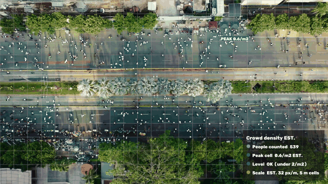
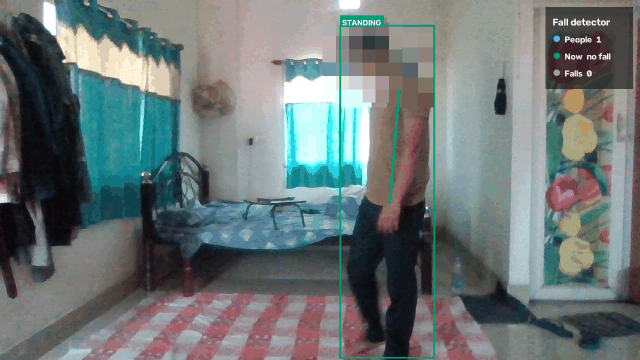
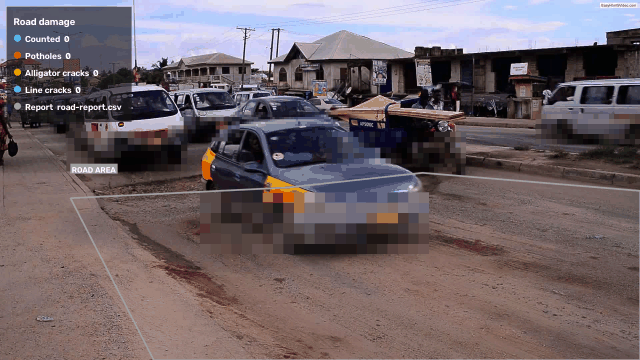
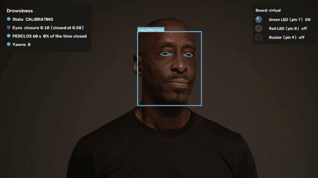
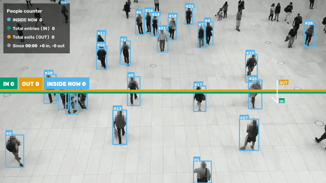
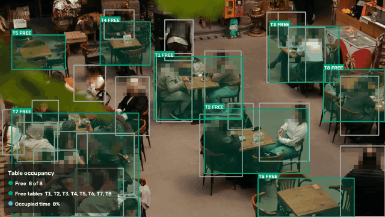
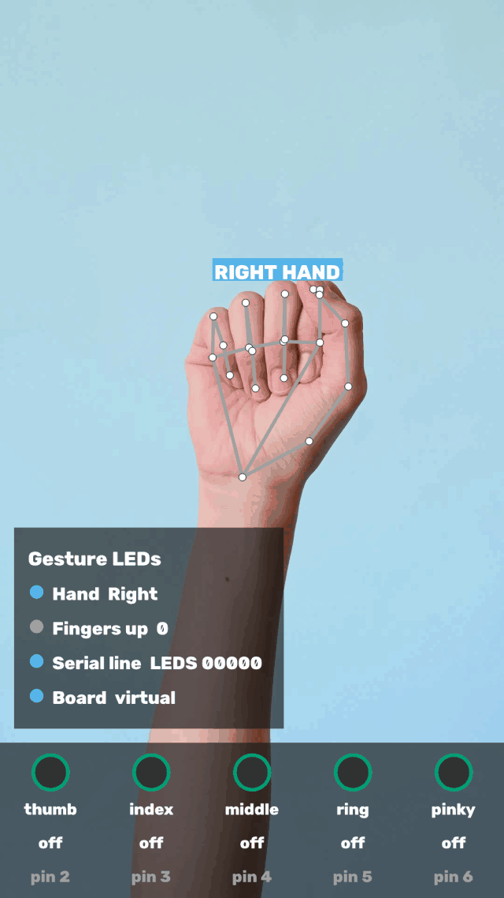
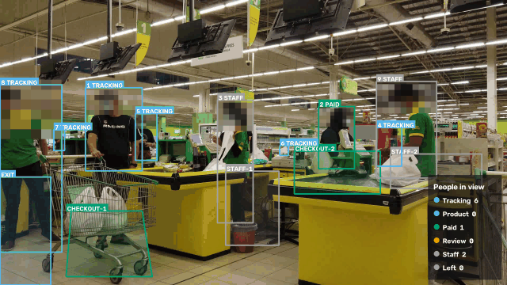
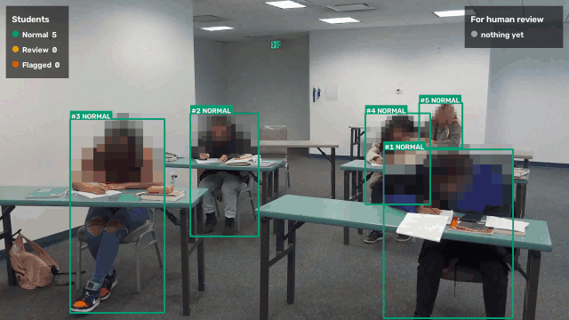
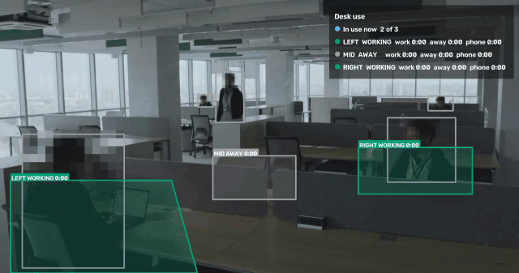

# vigia

Ten computer-vision systems for real problems (crowd crush risk, falls in care homes, damaged roads, drowsy
drivers, free tables, occupancy counts), running on an ordinary laptop with no cloud and no AGPL models.

Each demo is a small state machine on top of one shared pipeline (detect → track → pose → zones → events). The
logic is plain Python tested without video or network; the videos are only there to show it works.

| | Demo | Problem it solves |
|---|---|---|
|  | [**crowd**](vigia/apps/crowd_density) | Estimated people per m² on a ground grid, flagging cells that stay above a density threshold (built with Seville's Semana Santa and Feria in mind; it undercounts very dense crowds) |
|  | [**fall**](vigia/apps/fall_detector) | Falls of elderly or ill people, told apart from sitting or lying down on purpose; evaluated on a public dataset |
|  | [**road**](vigia/apps/road_damage) | Potholes and cracks, each counted once, with a CSV report a city could act on |
|  | [**drowsy**](vigia/apps/drowsiness) | Eyes-closed alarm for drivers and machine operators, with an Arduino buzzer |
|  | [**count**](vigia/apps/people_counter) | People in, out and inside right now through a doorway (real occupancy, not a running total) |
|  | [**tables**](vigia/apps/table_occupancy) | Which café tables are free, and for how long the others have been taken |
|  | [**hands**](vigia/apps/gesture_leds) | Touchless control: raised fingers drive five LEDs on an Arduino |
|  | [**store**](vigia/apps/store_flow) | Shop paths (shelf, checkout, exit), flagging exits without checkout for a human to look at |
|  | [**exam**](vigia/apps/exam_monitor) | Exam moments worth a human review (phone in hand, sustained side look), never a verdict |
|  | [**desk**](vigia/apps/desk_activity) | Which desks are actually used, for hot-desking and space planning |

Every GIF pixelates faces, heads and number plates, except the drowsiness one, where the face of the stock actor is the
subject; each demo's README says what was measured, what was not, and its limits.

## Run it

Needs [uv](https://docs.astral.sh/uv/) (it installs Python 3.12 for you). Tested on Windows 11; CI runs the unit
tests on Windows and Linux.

```bash
git clone https://github.com/angelmunizpedraza/vigia
cd vigia
uv sync --python 3.12 --all-extras
uv run python scripts/get_samples.py          # sample videos from their original source
uv run vigia tables --source samples/table_occupancy/cafe-from-above.mp4 --show
```

`uv run vigia` lists the demos; `uv run vigia <demo> --help` shows each one's options. Every demo takes a video
file, a webcam index (`--source 0`) or a stream (`rtsp://…`), and can save the annotated result
(`--out result.mp4` or `.gif`). Models download on first use. Draw zones for your own camera with
`uv run vigia zones my-video.mp4 --out scenes/my-scene.json`.

## Speed

Measured on an Intel Core Ultra 7 258V laptop with OpenVINO 2026.4 (`scripts/bench.py`), one D-FINE pass at 640×640:

| Model | CPU | NPU |
|---|---|---|
| D-FINE-S | 93 ms | 15 ms |
| D-FINE-M | 224 ms | 21 ms |

Whole demos cost more than one pass: crowd runs ~145 tiles per 4K frame (about 11.5 s per frame on the CPU, 2.6 s on
the NPU) and road about 3 s per frame on the CPU. Both are meant for recorded video with `--every`, not live. The
published results were made with D-FINE-M on the NPU; add `--model m` on a CPU to reproduce them (slower).

vigia uses the Intel NPU when there is one and the CPU otherwise. Before trusting an accelerator it was checked box
by box against the CPU (`scripts/check_accelerator.py`): the NPU found 99.5-100 % of the people the CPU found. The Arc
GPU looked 25× faster but, with OpenVINO 2026.4, found only 32-77 % of them, so vigia never picks it on its own.
Run both scripts on your machine before quoting numbers.

## Design choices

- **Logic you can test.** Each `apps/<demo>/logic.py` takes plain tracks with a timestamp and returns states and
  events, so `uv run pytest` covers the behaviour (debouncing, ID switches, empty frames, edge cases) in seconds,
  with no models, videos or network.
- **Time comes from the video**, not the wall clock, so a recording gives the same result on any machine.
- **Licences you can ship.** D-FINE and RF-DETR (Apache-2.0) instead of Ultralytics YOLO (AGPL-3.0);
  `supervision` pinned to 0.29.1 because later versions pull a GPL FFmpeg build. Details in
  [THIRD_PARTY.md](THIRD_PARTY.md).
- **Privacy by default.** Saved output pixelates faces, heads and number plates; demos work on zones and anonymous track ids,
  never on who someone is; no face recognition anywhere.
- **Accessible output.** Colour-blind-safe palette and every state written as text, never colour alone.

## Responsible use

Two demos touch areas the EU AI Act lists as high-risk: monitoring students during exams (Annex III 3(d)) and
monitoring workers (Annex III 4(b)). They are demos of the technique, not products: they flag moments for a person
to review, infer no emotions (banned at work and in education, art. 5(1)(f)) and say so in their READMEs, along with
Spain's rules on workplace cameras. The fall and drowsiness demos are not certified safety devices.

## Credits

Inspired by Huseyn's write-ups on Medium, which describe the idea of nine of these systems (no code was published
with them; everything here is written from scratch):
[people counting](https://huseyntech.medium.com/real-time-supermarket-people-counting-system-using-computer-vision-36d532c89e6c),
[anti-cheating CCTV](https://huseyntech.medium.com/building-an-ai-powered-anti-cheating-cctv-system-e408388f579a),
[fall detection](https://huseyntech.medium.com/ai-fall-detection-with-temporal-computer-vision-d65e18bc12f0),
[employee monitoring](https://huseyntech.medium.com/ai-employee-monitoring-using-computer-vision-1393052d0636),
[store behaviour](https://huseyntech.medium.com/ai-store-suspicious-behavior-detection-with-computer-vision-c1b6af290cc9),
[café tables](https://huseyntech.medium.com/ai-cafe-table-occupancy-detection-with-yolo-and-opencv-9660ecf71774),
[road damage](https://huseyntech.medium.com/ai-road-damage-detection-using-yolo-78b6c1016691),
[anti-sleep](https://huseyntech.medium.com/anti-sleep-system-eye-detection-and-alert-system-0396da9313ab),
[gesture LEDs](https://huseyntech.medium.com/controlling-leds-with-hand-gestures-using-python-and-arduino-f0c32b752abd).
The crowd-density demo is new.

Models, datasets and sample videos belong to their authors: see [THIRD_PARTY.md](THIRD_PARTY.md).

## Licence

Code: MIT © Ángel Muñiz Pedraza. The GIFs keep their sources' licences (see [THIRD_PARTY.md](THIRD_PARTY.md); `road.gif` is
CC BY-SA 4.0).
