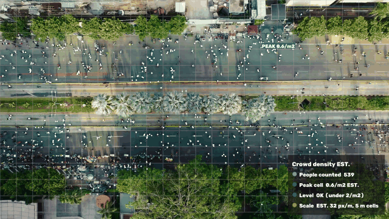

# Crowd density

How many people per square metre are there in each part of a crowd, and is any part getting dangerously packed?



*Estimated density (EST.): the scale comes from the size of the people themselves, see below. Every white dot is a
person counted; from this height nobody is recognisable, and saved output pixelates head areas anyway.
Video: Tom Fisk on [Pexels](https://www.pexels.com/video/aerial-view-of-people-walking-in-the-streets-2088290/),
processed at 1 frame per second.*

## Why Seville

In Seville a packed crowd is a *bulla*. In Semana Santa the processions move through the narrow streets of the old
town and people press in to see the *pasos*; during the Feria de Abril the fairground and the streets around it fill
up for a week. Crowd-safety guidance puts the danger zone at roughly 4-5 people per square metre and above (sources
under [Levels](#levels)). The idea: a camera fixed over a street, or a drone holding still, that shows stewards which
stretch is filling up while there is still time to close an access or open an exit.

There is no Seville footage here. The sample is a festival street filmed from a drone, and every number below is
about that clip only.

## Run it

```bash
uv run python scripts/get_samples.py crowd_density
uv run vigia crowd --source samples/crowd_density/street-festival.mp4 --every 30 --show
uv run vigia crowd --source samples/crowd_density/street-festival.mp4 --every 30 --seconds 24 --out docs/gifs/crowd.gif
```

`--every 30` processes one frame per second of video: a 4K frame takes about 2.6 s on an Intel NPU and about 11.5 s on
the CPU (Core Ultra 7 258V), so the full 37 s clip takes about 2 or 7 minutes.

## How it works

1. **People.** D-FINE runs on overlapping 320 px tiles of the 4K frame plus the whole frame. Each tile is resized to
   640 px, a 2x zoom, because most people here are 20-60 px wide.
2. **Scale (metres).** Three ways, best first:
   - **Calibrated:** 4 points in the image whose positions on the ground you know in metres (the corners of a
     square, a pedestrian crossing, a measured plaza). This works for any camera angle: people are placed at their
     feet, and the grid is drawn in perspective.
   - **Known px per metre:** for a camera looking straight down at a known height (`--px-per-m`).
   - **Estimated (EST.):** the median width of the person boxes divided by the metres one box spans (`person_m`,
     0.45 m by default, an adult's shoulders seen from above). It is re-estimated on every frame, so a drone going
     up or down is followed. This needs a camera looking straight down, and the panel and the events say EST.
3. **Grid.** The ground is cut into square cells (`cell_m`). Each cell gets people/m², counting a person at the
   centre of the box (from above) or at the feet (calibrated). Cells less than half inside the area are skipped: a
   sliver at the edge would turn one person into a huge density.
4. **Levels and alert.** Each cell is OK, DENSE or ALERT. A `density_alert` event fires once when a cell stays at
   ALERT for `--hold` seconds, timed with the video clock, so it works at 1 frame per second too.

### Levels

| On screen | People/m² | What the references say |
|---|---|---|
| OK | under 2 | |
| DENSE | 2 to 4 | Fruin's walkway level F starts above 2 people/m² (under 0.5 m² each); G. Keith Still gives 2/m² as a typical event safety limit |
| ALERT | 4 and above | Still gives 4/m² for moving queues and 5/m² as the upper limit for standing and viewing areas; Fruin's queuing level E covers 3.7-5.3/m² and level F is above 5.3/m² |

Fruin's levels of service (A best, F worst) as tabled by the US Federal Highway Administration
([FHWA, tables 3 and 21](https://www.fhwa.dot.gov/publications/research/safety/pedbike/98107/section3.cfm)):
walkways A under 0.31, B 0.31-0.43, C 0.43-0.71, D 0.71-1.1, E 1.1-2.0, F over 2.0 people/m²;
queuing areas A under 0.83, B 0.83-1.08, C 1.08-1.54, D 1.54-3.7, E 3.7-5.3, F over 5.3 people/m².
Still's figures: [gkstill.com, static crowd density](https://gkstill.com/Support/crowd-density/CrowdDensity-1.html).
Change the thresholds with `--amber` and `--red` to follow the guidance that applies to your event.

### Options

| Option | Default | Meaning |
|---|---|---|
| `--tile` | 320 | tile side in px; smaller zooms in more, costs more |
| `--conf` | 0.3 | detection confidence; people seen from above score low |
| `--cell-m` | 2 (5 in this clip's scene) | grid cell side in metres |
| `--px-per-m` | none | known scale, turns the estimate off |
| `--person-m` | 0.45 (1.0 in this clip's scene) | metres one person box spans, for the estimate |
| `--amber` | 2 | people/m² for DENSE |
| `--red` | 4 | people/m² for ALERT |
| `--hold` | 3 | seconds at ALERT before a `density_alert` |

The scene file (`scenes/crowd.json`, or `--scene`) can hold the same values in `params`, plus:

- a zone named `area`: the ground people can stand on (the grid covers only that);
- a zone named `calibration` (4 points, drawn with `uv run vigia zones <video> --out scenes/my-street.json`) and
  `params.calibration_m`: the same 4 points in metres, in the same order, typed into the JSON by hand. For example,
  `"calibration_m": [[0, 0], [12, 0], [12, 20], [0, 20]]` for the corners of a 12 x 20 m rectangle.

Events go to `out/crowd-events.jsonl`: `density_alert` with the cell (row, column), its density, when it reached
ALERT and whether the scale was estimated.

## Measured

Everything here is on the sample clip (4K, 30 fps, 37 s), checked by me on still frames. It is a sanity check, not
a benchmark.

**Tile size.** On the frames at 0 s and 36 s (confidence 0.4):

| Tile | Tiles per frame | People found (0 s / 36 s) | Time per frame |
|---|---|---|---|
| 640 | 40 | 63 / 139 | 2.0-2.1 s |
| 480 | 66 | 87 / 237 | 3.0-3.2 s |
| 320 | 144 | 274 / 430 | 6.9-8.5 s |

240 and 160 px tiles took roughly 1.7x and 4x as long as 320, and found no more people in the first two crops
counted by hand below. Times were measured on an Intel NPU while other jobs were using it, so take them as rough. The GIF run took
225 s for 24 frames, face pixelation included.

**Count by hand.** In three 400 x 400 px crops of the 4K frame, I counted people by hand and compared with the
detector (tile 320, confidence 0.3):

| Crop | By hand | Detector |
|---|---|---|
| 0 s, scattered walkers | 26 (25-28 counting people cut by the edge) | 25 |
| 36 s, small groups | about 36 (35-39) | 41 |
| 18 s, a close walking group | about 43 (41-48) | 22 |

The two sparse crops come out close, but partly by luck: some people get two or three boxes from overlapping tiles
(and a pushcart got one), which makes up for the people missed. In the close group, most people get no box at all:
the 22 boxes cover about 16 different people. Confidence 0.25 does not fix that (26 boxes) and makes the sparse
crops overcount (34 and 55).

**Scale.** At 0 s, the dashed lane lines measure about 100 px per dash and repeat every 252-262 px, with lanes about
100 px apart. If they are the common pattern of 3 m dash and 5 m gap (their ratio, 0.39, fits 3/8), that is about
32 px/m with 3 m lanes. The median person box is 32 px wide, so on this clip a box spans about 1 m (arms, stride,
the slight camera tilt), not the 0.45 m of a person standing still. With 0.45 m the scale would be 71 px/m and the
lanes would come out 1.4 m wide, impossible for a road. This is why this clip's scene sets `person_m` to 1.0. It is a cross-check that rests on
an assumption about the road markings, not a calibration, which is why everything stays EST.

**On the clip.** At 1 frame per second, the frames I checked had 540-850 people counted, and the peak cell (5 x 5 m)
never went above 0.92 people/m² (EST.). It never reached DENSE, so there is no `density_alert` on this video: the
alert and the levels are covered by the unit tests (`tests/test_crowd_density.py`). The calibrated path is tested
with a synthetic camera only, not with a real measured site. The density itself is not measured against ground
truth.

## Limits

- **It undercounts dense crowds.** Boxes need to see each person apart. In the close group above, the detector
  found about 16 of 43 people. In a real *bulla* at 4 people/m² or more it would miss far more, so read every
  density as a lower bound. The next step would be a density-map counting model: one trained on dense crowds that
  estimates how many heads there are per pixel instead of drawing a box around each person.
- Overlapping tiles sometimes give one person two boxes, which inflates the count in sparse areas.
- The estimated scale needs a camera looking straight down and something to check `person_m` against. Walking
  people span more than standing ones. A calibration, when you can do one, removes that guess.
- The grid is fixed to the image. The camera (or drone) must hold still, or a cell drifts over the ground, and the
  `--hold` timer no longer watches one place.
- Stalls, umbrellas and goods on the ground confuse the detector (bottom left of the clip).
- Small cells are noisy: in a 2 m cell, one person more or less changes the density by 0.25/m². This clip uses 5 m
  cells (0.04/m² per person), which also keeps the grid readable in a 640 px GIF.
- 2.6 s (NPU) to 11.5 s (CPU) per 4K frame: fine for watching how density builds up, not for following individuals.
- It counts people and never identifies anyone. It is a demo, not a certified crowd-safety system.

## Data

Sample video: "Aerial view of people walking in the streets" by Tom Fisk,
[Pexels](https://www.pexels.com/video/aerial-view-of-people-walking-in-the-streets-2088290/), Pexels License. It
is downloaded by `scripts/get_samples.py` and not redistributed; the GIF shows it downscaled, with the analysis on top.
