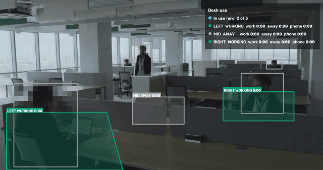

# Desk activity

Which desks in an office are actually used, and for how long? Built for hot-desking and space planning, not for
watching people.



*Faces and heads are pixelated. Sample from 0:14 to the end. Video: cottonbro studio on [Pexels](https://www.pexels.com/video/men-working-in-the-office-5484894/).*

## Run it

```bash
uv run python scripts/get_samples.py desk_activity
uv run vigia desk --source samples/desk_activity/office.mp4 --show
```

On your own camera, draw each desk area once (name them `desk-1`, `desk-2`…: chair plus desk top, where a seated
person's legs and lap are), then run on the stream:

```bash
uv run vigia zones my-office.mp4 --out scenes/my-office.json
uv run vigia desk --source rtsp://camera/stream --scene scenes/my-office.json --show
```

## How it works

1. D-FINE finds people and phones (`cell phone`) in each frame. No tracker: nothing follows a person from desk to
   desk.
2. Someone is *seated* at a desk when at least 25 % of the lower half of their box (chair, lap, desk top) lies
   inside the desk area. A person walking past or standing next to the desk does not.
3. Each desk is in one of three states:
   - **WORKING**: someone seated there for 2 s (a short crossing does not count; gaps under 1 s in the detections
     are ignored).
   - **AWAY**: nobody seated for 10 s.
   - **PHONE**: a phone inside the seated person's box (in the hands or at the ear) for 3 s; back to WORKING after
     3 s without it. A phone lying elsewhere on the desk does not count, and neither does a phone at an empty desk.
4. The first frame is taken as it is (a desk with someone seated starts as WORKING); after that every change waits
   for its delay, and the time spent waiting is credited to the new state, so the seconds per state add up to the
   real timeline.
5. The panel shows how many desks are in use now and, per desk, the time spent WORKING, AWAY and on the PHONE.

State is kept per desk zone, never per person: there are no ids, names or faces in the output.

| Option | Default | Meaning |
|---|---|---|
| `--away-after` | 10 | seconds with nobody seated before a desk counts as AWAY |
| `--phone-after` | 3 | seconds a phone must be seen in the seated person's hands before PHONE |

Every change goes to `out/desk-events.jsonl` (`desk_working`, `desk_away`, `desk_phone`, each with the desk and the
time the new state really began).

## Measured

On the sample clip (45 s, 3 desks, `--every 3` so 8.3 frames/s processed), every state change checked by hand
against the frames:

| Desk | What happens in the video | What the system says |
|---|---|---|
| left | The man vanishes in a quick dissolve at 27.8-28.1 s (an edit in the stock clip, not a walk out of frame) | WORKING until AWAY at 38.0 s, dated back to 28.0 s |
| right | Same kind of dissolve at about 30.4 s | WORKING until AWAY at 40.6 s, dated back to 30.5 s |
| middle | A man walks up from the back (7-18 s), stands beside the desk pulling the chair (18-22 s) and sits at about 22.5-23 s | AWAY while he walks up and stands there; WORKING at 24.6 s, dated back to 22.6 s |

- The AWAY change comes 10 s after the desk empties, by design (`--away-after`); the dated-back start matches the
  frames within 0.2 s. There are no other state changes in the clip.
- Time per state at the end: left 28.0 s working / 16.9 s away, right 30.5 / 14.4, middle 22.3 / 22.6.
- A desk power socket is detected as a `cell phone` in many frames (confidence 0.30-0.47 in the frames checked). It
  never sets PHONE, because it is not in a seated person's hands, and it is not drawn.
- **The sample shows no phone use**, so PHONE is covered only by the unit tests (`tests/test_desk.py`), not by
  video. The departures are edits, so a person standing up and walking away is not shown either.

The GIF is the same clip from 0:14 to the end (a trimmed copy, `--every 3`); its panel counts time from 0:14. One
clip is a sanity check, not a benchmark; detection speed was not measured here.

## Limits

- The camera must not move; if it does, redraw the zones. (The second sample, `office-above.mp4`, pans slowly, so
  fixed zones do not fit it and it is not used here.)
- Someone sitting at a desk that is not theirs, or a visitor standing very close, counts as WORKING after 2 s: the
  system knows desks are used, not by whom, by design.
- A phone held below the desk, hidden by a divider or too small to detect is missed; a phone on the desk right in
  front of the seated person counts as PHONE.
- Dividers that hide most of a seated person can push the overlap under 25 %; draw the zone over the part of the
  chair and body that stays visible.
- How often D-FINE finds a phone held in the hand at office-camera distance is not measured; small or partly hidden
  phones will be missed.
- The first frame is taken as it is: someone passing a desk in that very frame makes it WORKING until 10 s after
  they are gone.

## Responsible use

This demo measures **desk and space utilisation** (how many desks are used, which ones stand empty, whether a floor
needs fewer fixed desks). Do not turn it into a tool to watch or score individual workers:

- **EU AI Act**, Annex III point 4(b): AI systems intended to monitor and evaluate the performance and behaviour of
  people in work relationships are **high-risk**, with the obligations that come with that. Emotion recognition at
  work is prohibited outright (art. 5.1(f)); this demo infers no emotions.
- **Spain**, art. 89 LOPDGDD (Ley Orgánica 3/2018): an employer may use cameras for the control allowed by art. 20.3
  of the Estatuto de los Trabajadores only within its legal limits, and must **inform workers (and their
  representatives, if any) beforehand**, expressly, clearly and concisely. Never in rest areas, changing rooms or
  toilets.
- Art. 20.3 of the Estatuto de los Trabajadores: the employer may check that work duties are met, with due regard
  for the worker's dignity in how the measure is chosen and applied.

Practical defaults that follow from this: count per desk, keep no identities, pixelate faces in anything saved
(on by default), keep only aggregates (time per state) and tell people the camera is there and what it measures.

## Data

Sample videos are downloaded by `scripts/get_samples.py` and are not in the repo (Pexels License):
`office.mp4` by cottonbro studio ([Pexels 5484894](https://www.pexels.com/video/men-working-in-the-office-5484894/)),
`office-above.mp4` by fauxels ([Pexels 3252858](https://www.pexels.com/video/a-group-of-people-with-laptops-are-busy-working-in-a-room-3252858/)).
