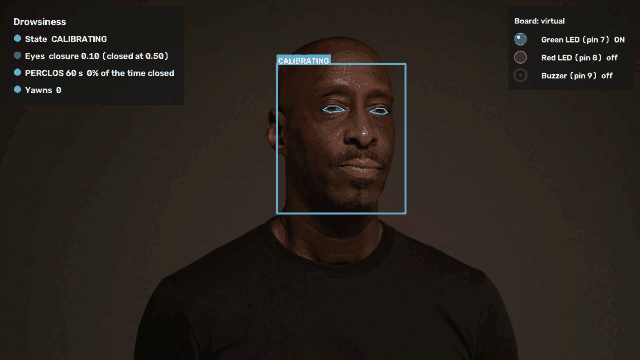

# Drowsiness alarm

Sound an alarm when a driver's or operator's eyes stay closed too long, and tell an Arduino to beep.



*The face is not pixelated in this demo: pixelation would hide the eyes, which are what it measures. The man is a
stock actor. Video: Ketut Subiyanto on [Pexels](https://www.pexels.com/video/a-man-covering-his-mouth-while-yawning-4588464/)
(Pexels License).*

**This is a demo, not a certified safety device.** Do not rely on it to keep anyone awake. Real use needs a camera
fixed on the dashboard, night-time (infrared) lighting and testing with real drivers.

## Run it

```bash
uv sync --python 3.12 --all-extras        # MediaPipe and pyserial included
uv run python scripts/get_samples.py drowsiness
uv run vigia drowsy --source samples/drowsiness/man-yawning.mp4 --show
```

**Try it on yourself** with your webcam: keep your eyes open for the first 5 s (calibration), then close them for
2 s. The on-screen board turns red and its buzzer icon lights up. `q` quits.

```bash
uv run vigia drowsy --source 0 --show
```

With a real Arduino on `COM3` (Windows) or `/dev/ttyACM0` (Linux), see [Real Arduino](#real-arduino):

```bash
uv run vigia drowsy --source 0 --show --board serial:COM3
```

## How it works

1. MediaPipe Face Landmarker (video mode) finds 478 face points and blendshape scores on every frame.
2. **Eyes closed** when the mean of the `eyeBlinkLeft` and `eyeBlinkRight` scores reaches 0.5. If the blendshapes
   are missing (or with `--signal ear`), it uses the eye aspect ratio (EAR: lid gap over eye width, from six points
   per eye) against a calibrated threshold.
3. **Calibration** learns the open-eye EAR over the first 5 s with a face: threshold = 0.75 × the 90th percentile of
   the EAR. The 90th percentile, not the median, because the person may close their eyes during those 5 s. The man
   in the sample does, for more than 80 % of them: a median-based threshold would have been 0.086 and would have
   read 88 of his 151 closed-eye frames as open (see Measured). If calibration never sees open eyes (90th percentile
   under 0.18; open eyes gave 0.21-0.31 on the sample), it keeps a default threshold of 0.2. Calibration only tunes
   the EAR fallback: the alarm works from the first frame.
4. **EYES CLOSED** starts the timer; after 1.5 s it becomes **ALARM**. A blink (0.1-0.4 s) never reaches it. A
   closure ends only after 0.2 s of open eyes, so one noisy frame does not restart the timer.
5. **PERCLOS**: share of the last 60 s with the eyes closed (only the seconds seen so far, at the start), a common
   drowsiness measure.
6. **Yawns**: `jawOpen` at 0.25 or more for 0.15 s. Openings that start less than 6 s apart (about one yawn's
   length) count once, because a hand over the mouth splits one yawn into two sightings. Yawns are a warning count;
   they never trigger the alarm.
7. The board gets `ALARM` while the alarm lasts and `OK` otherwise.

It reads three blendshapes only (`eyeBlinkLeft`, `eyeBlinkRight`, `jawOpen`) and never infers emotions or
expressions: the EU AI Act bans emotion recognition at work and in education (art. 5(1)(f)); eye closure and
yawning are physical states (recital 18). On-screen labels are neutral: EYES OPEN, EYES CLOSED 1.8 s, ALARM, YAWN.

| Option | Default | Meaning |
|---|---|---|
| `--closed-alarm` | 1.5 | seconds with the eyes closed before the alarm |
| `--calib-seconds` | 5 | seconds of face used to learn the open-eye EAR |
| `--blink-threshold` | 0.5 | mean `eyeBlink` score from which the eyes count as closed |
| `--yawn-open` | 0.25 | `jawOpen` score that counts as a wide-open jaw |
| `--yawn-seconds` | 0.15 | seconds the jaw must stay open to count a yawn |
| `--signal` | blink | `blink` (blendshapes, EAR only if they are missing) or `ear` (calibrated EAR only) |
| `--board` | virtual | `virtual` (drawn on screen), `none`, or `serial:<port>` |

Events go to `out/drowsy-events.jsonl`: `calibrated` (open EAR and threshold), `eyes_closed_alarm`,
`alarm_cleared` (how long the eyes were closed) and `yawn`.

## Real Arduino

**The sketch has not been compiled or tested on a board** (no Arduino was available). It is short and uses only
`digitalWrite` and `Serial`, but check it before relying on it.

Upload [`firmware/drowsiness/drowsiness.ino`](../../../firmware/drowsiness/drowsiness.ino) to an Arduino Uno (or
any board with 5 V pins) and wire:

| Part | From | Through | To |
|---|---|---|---|
| Green LED | pin 7 | 220 Ω resistor → LED long leg (anode) | LED short leg (cathode) → GND |
| Red LED | pin 8 | 220 Ω resistor → LED long leg (anode) | LED short leg (cathode) → GND |
| Active buzzer (5 V) | pin 9 | buzzer + | buzzer − → GND |

An active buzzer beeps on its own when powered (a passive one needs `tone()` and stays silent here). If yours draws
more than 20 mA, the recommended limit for an Uno pin, drive it through a transistor.

Protocol (9600 baud, one line per message): `ALARM` or `OK` as soon as the state changes, and every 0.5 s `HB`
followed by the current state again. The repeat is there because opening the port resets an Uno, and whatever is
sent while it boots is lost. **If the board hears nothing for 2 s, both LEDs blink** and the buzzer stays off: the
driver can see that nothing is watching (program closed, cable pulled, computer frozen). If the cable is pulled
while the program runs, the on-screen board says `LOST` and the program keeps going.

## Measured

On the sample clip (8.8 s, 25 fps, 220 frames, 1920×1080), checked against the model's scores for every frame and
against frames of the output video:

- The face was found in all 220 frames, including while the hand covers the mouth.
- His eyes are open until about 0.9 s, closed from about 1.0 s to 7.1 s, and open again until the end. The mean
  `eyeBlink` score is at most 0.29 with the eyes open and at least 0.53 with them closed, so the 0.5 threshold never
  flickers on this clip (it is crossed once on the way down, at 0.96 s, and once on the way up, after 7.08 s). EAR:
  0.21-0.31 open, 0.04-0.15 closed.
- EYES CLOSED from 0.96 s, **ALARM at 2.48 s**, cleared at 7.32 s (eyes closed for 6.16 s). With `--signal ear`:
  ALARM at 2.40 s, cleared at 7.40 s.
- Calibration (0-5 s, 126 frames, 17 % of them with open eyes): 90th-percentile EAR 0.255, threshold 0.191, which
  sits between every open and every closed frame of the clip. The median EAR over the same 5 s is 0.115; 0.75 × that
  (0.086) would have read 88 of the 151 closed-eye frames from 1 s to 7 s as open.
- One yawn, counted at 1.64 s. The hand hides his mouth from about 2 s to 5.7 s; the model sees the jaw open only
  at the start (1.48-1.68 s) and as the hand moves away (5.88-6.12 s), with `jawOpen` peaking at 0.36. The two
  sightings are counted as one yawn.
- PERCLOS at the end: 70 %.

Not measured: accuracy on real drivers, at night, with glasses or sunglasses, on other faces and skin tones, or how
often talking is counted as a yawn. The webcam path (`--source 0`) and a real serial port were not tried while
building it (the serial protocol is tested over pyserial's `loop://`). Speed was not benchmarked (the machine was shared with other jobs during the
runs). One clip of one actor is a sanity check, not a benchmark. The other candidate clip (a driver, Pexels 4281278)
was not used: it films him from the side, and in the 8 frames checked (one every 6 s) his eyes are open.

## Limits

- Looking down (at a phone or the gear stick) lowers the eyelids and can read as closed eyes (not tested here); a
  camera in front of the face, at eye height, avoids most of it.
- Sunglasses hide the eyes. Ordinary glasses with reflections can confuse the landmarks.
- Yawn settings were tuned on one clip where a hand covers the mouth. Talking may open the jaw as far for as long;
  if a talking driver gets yawns counted, raise `--yawn-seconds` (to 1, say).
- If the face is lost while the eyes are closed (a head dropping forward out of view), the alarm keeps going until
  open eyes are seen again. Losing the face with the eyes open shows NO FACE, without an alarm.
- Microsleeps with the eyes open, or drowsiness without long eye closures, are not detected.
- PERCLOS here counts any closure over the threshold, not the classic P80 (lids at least 80 % closed).
