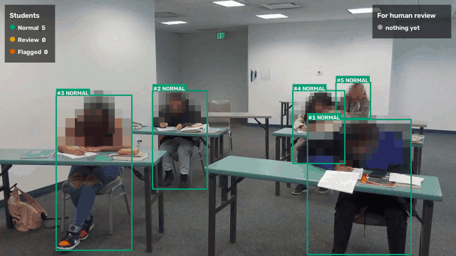

# Exam monitor

Point an invigilator at the moments of an exam worth a second look (a phone at a student's hand, a long look to the
side) with a timestamp, instead of hours of video. It flags moments for a human to review; it never gives a verdict.



*Faces and heads are pixelated. The scene is staged: the photographer filmed actors playing students. Video: RDNE
Stock project on [Pexels](https://www.pexels.com/video/7092083/) (Pexels License). GIF made with `--every 4`
(7.5 frames/s) to stay under 8 MB.*

## Run it

```bash
uv sync --python 3.12 --all-extras        # RTMPose included
uv run python scripts/get_samples.py exam_monitor
uv run vigia exam --source samples/exam_monitor/exam-room.mp4 --every 3 --show
```

No zones to draw: it works on whoever is in view. On your own camera (in front of the students):

```bash
uv run vigia exam --source rtsp://camera/stream --every 3 --show
```

## How it works

1. D-FINE finds people and phones (`cell phone`) in each frame; ByteTrack gives each person a number for as long as
   the track lasts. Phones are small, so they have their own confidence (`--phone-conf`). A person box lying mostly
   inside a more confident one (an upper-body duplicate) is dropped.
2. RTMPose finds 17 body keypoints in each person box. A person counts as a student only if their shoulders (at
   least a quarter of the box wide) or a clearly visible forearm are found: a bag or a coat at the frame edge, where
   the pose model can only guess, does not.
3. Two signals, both read from the keypoints:
   - **PHONE**: a phone is given to the student whose wrist is nearest, within 0.6 × that student's shoulder width
     (from a forearm if the shoulders are out of view). A phone in nobody's reach goes to the student whose box
     contains it. It must be seen twice within 0.5 s (one frame of a pen or a calculator does not count) and stays
     on for 0.5 s after the last sighting, because small phones flicker in and out of detection.
   - **SIDE LOOK**: head turn from the nose's sideways offset to the shoulder midpoint, normalised by the shoulder
     width; 35° or more. If both ears are visible and the nose sits in the middle half between them, the face is
     towards the camera (the torso turned, not the head) and it does not count. **Looking down at the paper is not a
     signal**: bowing the head moves the nose down, not sideways.
4. Each student has a score in seconds of evidence: it rises by 1 per second while a signal is on and drains by 0.15
   per second while none is. **REVIEW** at 3, **FLAGGED** at 8. A state is left only when the score falls under half
   its threshold, so the label does not flicker. A glance of a second or two never reaches REVIEW.
5. Each student's label shows the number, the state and the signal seen now. The panel counts students per state and
   lists the latest moments for review, with the time the evidence started (where to start watching).

There is no face recognition and no identity: the numbers are tracker ids that last as long as the track. It infers
no emotions and gives no verdict.

| Option | Default | Meaning |
|---|---|---|
| `--side-look-deg` | 35 | head turn, in degrees, that counts as a side look |
| `--review` | 3 | seconds of evidence before REVIEW |
| `--flagged` | 8 | seconds of evidence before FLAGGED |
| `--person-conf` | 0.4 | detector confidence for people |
| `--phone-conf` | 0.4 | detector confidence for phones |

Every moment goes to `out/exam-events.jsonl`: `review_started` and `flagged`, each with the student number, the time
the evidence started (`from`), the score and the signals seen at that moment.

## Measured

On the sample clip (7.7 s, 1920×1080, 30 fps; `--every 3`, so 77 frames at 10 frames/s), every event checked
against the frames:

| Student | What happens in the video | What the system says |
|---|---|---|
| #2, leather jacket (middle left) | Turns his head to his left, towards the student in the beige coat, from about 1.4 s, talking and gesturing; back to his paper at about 6.2 s | SIDE LOOK from 1.9 s, **REVIEW at 4.8 s** (evidence from 1.9 s); still REVIEW at the end while the score drains |
| #1, blue jacket (front right) | Writes the whole time, head down. A phone lies on his desk, on a book next to his writing hand; he never picks it up | PHONE from 2.9 s, **REVIEW at 6.4 s** (evidence from 2.9 s) |
| #4, beige coat (middle right) | Looks over towards #2 at about 2.0-3.0 s and again at about 4.3-6.0 s, at her paper in between | SIDE LOOK in both stretches; the score peaks at 2.4, under the 3 for REVIEW, so she stays NORMAL |
| #3, red top (front left), and #5 (back right) | Write with the head bowed over the paper | NORMAL, no signal: looking down is never read as a side look |

- The five students keep the same number for the whole clip and no other track becomes a student (a bag at the
  left edge and duplicate upper-body boxes are dropped).
- #1 is what the rule says (a phone next to a student's hand), but the rule cannot tell a phone lying there from one
  in use: a reviewer would dismiss this moment in seconds. That is what REVIEW is for.
- Nothing reaches FLAGGED in 7.7 s (it needs 8 s of evidence), so FLAGGED is covered only by the unit tests
  (`tests/test_exam.py`), not by this video.
- In a pass over all 231 frames, the phone on #1's desk is above the 0.4 phone threshold in 116 of them (up to
  0.77). Other desk objects, a calculator on #3's desk among them, pass 0.4 in a single frame each (at most 0.46)
  and are ignored by the two-sightings rule.
- The camera zooms in slowly during the clip; with no zones to keep aligned, that does not matter here.
- The GIF run (`--every 4`) gives the same two reviews and the same end states: #2 at 4.9 s (evidence from 2.0 s),
  #1 at 6.4 s (from 3.1 s).

**Phone close-up** (`phone-closeup.mp4`, 5.3 s, vertical, `--every 2`), used to check phone detection and the wrist
rule, not for the GIF: the phone scores about 0.9 while uncovered. At 0.2 s it lies on the desk out of her reach and
goes to nobody; from about 0.7 s her hand is on it and it goes to her (only an arm is in view, so the forearm gives
the scale for the reach) until about 3.2 s, when it disappears under the paper. That is 2.2-2.4 s of evidence, under
the 3 s for REVIEW, so she stays NORMAL.

The third sample, `exam-room-back.mp4`, has a fixed camera (checked by eye over its 12 s) but films the class from
behind, with an invigilator walking about: most heads show no face to read, so it is not used. Not measured: how
often phones are missed or students reviewed for nothing in real exams, and speed (the machine was shared with
other jobs). One staged clip is a sanity check, not a benchmark.

## Limits

- The camera must face the students from the front, high enough to see every head and both shoulders. From
  behind there is no nose to read.
- Students sitting side by side and talking to each other, an invigilator walking between desks or a student
  stretching can all reach REVIEW. That is the point of a human review, not an error to hide.
- Small phones are often missed: under the desk, in a lap, covered by a hand, or far from the camera. A phone lying on
  the desk next to a student's hand counts as PHONE.
- Head turn comes from 2D keypoints. A student filmed from far to the side, or one whose shoulders are hidden by the
  desk in front, gives a noisy or no reading.
- The tracker can give a student a new number after an occlusion; the score then starts again from zero.
- Thresholds were tuned on one staged clip. Real rooms need their own tuning, and how often the system misses a
  phone or reviews a student for nothing is not measured.

## Responsible use

Read this before pointing a camera at students.

- **EU AI Act**, Annex III point 3(d): AI systems intended to be used for monitoring and detecting prohibited
  behaviour of students during tests in education and vocational training institutions are **high-risk**. Using
  one for real means the obligations that come with that: risk management, data governance, logging, transparency
  to the people affected and human oversight (arts. 9-15), among others. This repository is a free demo, not a
  product that meets them.
- **Emotion recognition in education is prohibited** (art. 5(1)(f)), outside medical or safety reasons. This demo
  infers no emotions, stress or "nervousness": it reads where a head points and whether a phone is near a hand.
- **No verdict.** The system flags moments for a human to review. A REVIEW or FLAGGED label is a timestamp to watch,
  never evidence of anything on its own. Labels are neutral on purpose.
- Students must be told the camera is there and what it looks for, and video needs a lawful basis and a retention
  limit under the GDPR. Faces are pixelated in anything saved (on by default; `--no-blur` turns it off).

## Data

Sample videos are downloaded by `scripts/get_samples.py` and are not in the repo (Pexels License). All three are by
RDNE Stock project and staged with actors: `exam-room.mp4` ([Pexels 7092083](https://www.pexels.com/video/7092083/),
used for the GIF), `exam-room-back.mp4` ([Pexels 7092062](https://www.pexels.com/video/7092062/)) and
`phone-closeup.mp4` ([Pexels 7092092](https://www.pexels.com/video/7092092/)).
