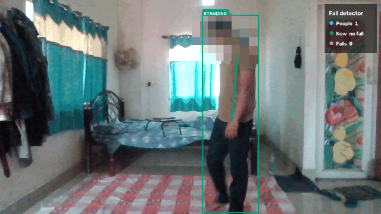

# Fall detector

Did someone fall, or did they just sit or lie down? Raise one alarm for a real fall and stay quiet for everyday
movements.



*Faces and heads are pixelated. Video: GMDCSA24, Alam et al., CC BY 4.0
([Zenodo](https://zenodo.org/records/12921216)), Subject 2, `Fall/01.mp4` (right side fall on the ground).*

> This is a demo, not a certified medical or safety device. Do not rely on it to protect anyone.

## Run it

GMDCSA24 is a manual download (1.1 GB extracted): get the zip from [Zenodo](https://zenodo.org/records/12921216) and
extract it under `samples/fall_detector/GMDCSA24/`.

```bash
uv run vigia fall --source "samples/fall_detector/GMDCSA24/<extracted folder>/Subject 2/Fall/01.mp4" --show
uv run vigia fall --source 0 --show          # webcam
```

## How it works

1. D-FINE finds the people, ByteTrack follows them, RTMPose gives 17 body keypoints inside each person box.
2. Per person it measures:
   - the **torso angle** from vertical, from the shoulder and hip midpoints (keypoint confidence 0.3 or more); when
     those are missing it falls back to the box shape;
   - how fast the torso centre drops, in **body heights per second** (the person's own standing height, so it
     works near or far from the camera); the fastest drop over any span of up to 1 s counts, so a fall the detector
     half-missed still shows;
   - the box height against the person's own **standing height**.
3. States: **STANDING / WALKING / SITTING** (upright), **FALLING** (fast descent), **LYING** (down, reached slowly),
   **FALL DETECTED**. A fast descent that ends down and stays down for the confirmation time raises the alarm;
   lying down slowly gives LYING, never an alarm; getting back up in time cancels it.
4. Each alarm goes to `out/fall-events.jsonl` (`fall_detected` with the time the descent started, the peak speed
   and the torso angle). One alarm per fall.

| Option | Default | Meaning |
|---|---|---|
| `--descent-speed` | 0.4 | torso drop speed, in body heights per second, that starts FALLING |
| `--lying-angle` | 60 | torso angle from vertical, in degrees, that counts as down (with the box below sitting height) |
| `--confirm-after` | 1.5 | seconds down after a fast descent before FALL DETECTED |
| `--recover-window` | 1.5 | seconds after a fast descent to end up down; still upright by then is a stumble or a brisk sit |

The defaults were tuned on GMDCSA24 subjects 1 and 2 only (see below). A box that is 45 % of the standing height or
less also counts as down, whatever the angle (someone lying along the camera's line of sight).

In saved output, faces are pixelated where the pose places the head (nose, eyes, ears) as well as at the top or the
ends of each person box, so someone bent over or lying down is covered too; each region stays hidden for 0.4 s when
the detector misses a frame.

## Measured

On every clip of [GMDCSA24](https://zenodo.org/records/12921216): 4 subjects, 79 staged falls and 81 clips of
activities of daily living (ADL), 2 to 17 s each. `scripts/eval_fall.py` runs this demo's own pipeline on one frame
in two (D-FINE-M on the Intel NPU, RTMPose on the CPU). A fall clip counts as detected if `fall_detected` fires at
least once; an ADL clip with any `fall_detected` is a false alarm.

**The thresholds were tuned on subjects 1 and 2 only** (a grid over descent speed, confirmation time, torso angle and
the speed window). Subjects 3 and 4 were run once, with the final defaults, after tuning. On the tuning subjects it
caught 36 of 41 falls with no false alarm on 39 ADL clips; that number is optimistic by construction.

**Held-out: subjects 3 and 4 (not used for tuning)**

| Fall clips detected (recall) | ADL clips with a false alarm | Precision (clips) |
|---|---|---|
| 24/38 (63%) | 4/42 (10%) | 86% |

| ADL kind | Clips with a false alarm |
|---|---|
| lying down or getting up (bed or floor) | 0/7 (0%) |
| exercise, yoga, push-ups | 3/7 (43%) |
| picking something up from the floor | 1/6 (17%) |
| sitting on or getting up from the floor | 0/6 (0%) |
| sitting on a bed or chair | 0/12 (0%) |
| walking, standing, other | 0/4 (0%) |

**All four subjects (includes the two used for tuning, so better than what to expect on new data)**

| Fall clips detected (recall) | ADL clips with a false alarm | Precision (clips) |
|---|---|---|
| 60/79 (76%) | 4/81 (5%) | 94% |

| ADL kind | Clips with a false alarm |
|---|---|
| lying down or getting up (bed or floor) | 0/14 (0%) |
| exercise, yoga, push-ups | 3/11 (27%) |
| picking something up from the floor | 1/12 (8%) |
| sitting on or getting up from the floor | 0/11 (0%) |
| sitting on a bed or chair | 0/23 (0%) |
| walking, standing, other | 0/10 (0%) |

Reproduce with `uv run python scripts/eval_fall.py samples/fall_detector/GMDCSA24/<extracted folder> --every 2`; it
also lists every clip it got wrong.

What it gets wrong on the held-out subjects:

- **Falls onto a bed** (8 of the 14 held-out misses, 6 of them subject 4 falling from sitting on the bed): from
  sitting on a bed to lying on it is a short drop, close to lying down on purpose, which this logic is built to
  ignore. Lying down on a bed on purpose gave no alarm (0 of 7).
- **Push-ups** (all 3 of subject 4's): dropping fast to the floor and staying horizontal looks like a fall.
- Falls in the dark (subject 4's "lights off" clips) and falls where the detector loses the person on the floor.
- The ADL kinds come from keywords in the dataset's descriptions; a clip with several activities is counted once.

The held-out run took 652 s for its 80 clips on a Core Ultra 7 258V shared with other jobs. In the GIF clip the
alarm fires at 4.0 s; the descent began at 2.5 s. Nothing here was measured on real (unstaged) falls.

## Limits

- **Staged falls by four subjects, indoors, one fixed camera per clip.** Real falls, older people, other rooms and
  cameras will behave differently; these numbers do not transfer to them.
- A fall needs to stay down for `--confirm-after` seconds: on a clip that ends right after the fall (some
  GMDCSA24 clips do) it cannot be confirmed. On a live camera this is only a delay.
- The detector loses people lying on the floor partly out of frame, or lying on a bed among the bedding. While
  nobody is detected nothing can be confirmed; a person that reappears within 3 s near where they were lost keeps
  their state, even under a new tracker id.
- One camera, no depth: a fall straight towards or away from the camera shows little angle change and relies on
  the box height alone.
- A very slow fall (sliding down a wall) is LYING, not a fall, by design.
- For a moment while someone stumbles, the label can read LYING before FALLING (the GIF shows one such frame).

## Data and credit

GMDCSA24: E. Alam, A. Sufian, P. Dutta, M. Leo, I. A. Hameed, "GMDCSA24: A Dataset for Human Fall Detection in
Videos", Data in Brief (2024), CC BY 4.0, [zenodo.org/records/12921216](https://zenodo.org/records/12921216).
The clips are not in this repository; the GIF is a derivative of one clip, under the same licence.
