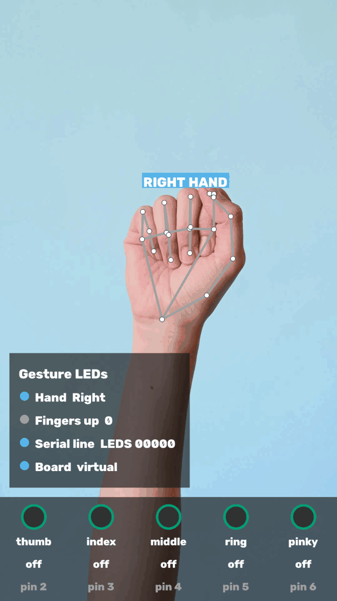

# Gesture LEDs

Raise fingers, light LEDs: one LED per finger, on screen or on an Arduino, from a plain camera.



*First 12 s of [a person doing hand signs](https://www.pexels.com/video/a-person-doing-hand-signs-9019617/) on
Pexels (Pexels License), processed at 8 fps. No face is in the clip; face pixelation stays on anyway.*

Where this kind of thing is useful: switching something without touching it, when hands are dirty or must stay
sterile (a kitchen, a lab, an operating room) or when buttons are hard to press (accessibility). This demo only
shows the first step, reading which fingers are up and sending that to a board. It is not a medical or safety
device and has not been tried in any of those places.

## Run it

```bash
uv sync --python 3.12 --all-extras        # MediaPipe and pyserial included
uv run python scripts/get_samples.py gesture_leds
uv run vigia hands --source samples/gesture_leds/hand-signs.mp4 --show
```

**Try it with your webcam**: hold one hand up, palm to the camera, and raise fingers. The preview is mirrored like
a selfie view. `q` quits.

```bash
uv run vigia hands --source 0 --show
```

With a real Arduino on `COM3` (Windows) or `/dev/ttyACM0` (Linux), see [Real Arduino](#real-arduino):

```bash
uv run vigia hands --source 0 --show --board serial:COM3
```

## How it works

1. MediaPipe Hand Landmarker (Tasks API, video mode) finds 21 points per hand on every frame.
2. **A finger is up** when its middle joint (PIP) is straight, at least 155°, **and** its tip reaches past that
   joint, away from the wrist, by at least 0.8 times the length of the finger's first bone. The second test is for
   a finger curled towards the camera: seen from the front it looks straight, but short.
3. **The thumb is up** when its IP joint is at least 140° and its tip is clear of the other fingers (at least 0.4
   palm lengths from every joint of the other four). A thumb folded across the palm, holding down a finger or
   touching a fingertip is down, wherever it points.
4. Only angles and distances between the hand's own points are used, never "is the tip to the left of the joint".
   So it works with the hand turned sideways or upside down, and the same rule serves both hands: a left hand is a
   mirror image of a right one, and mirroring keeps angles and distances. The original write-up compared x
   coordinates, which needs a different rule per hand and breaks when the hand rotates.
5. **Debounce**: the LEDs change only when the same reading holds for 3 frames in a row, so the in-between frames
   of a gesture do not blink the LEDs. No hand in view counts as all fingers down: the LEDs go off.
6. The board gets `LEDS 10110` (thumb..pinky) on every change.

**Webcam mirror.** MediaPipe always gets the raw camera frame, so its Left/Right label is the person's real hand.
Only the preview is flipped, like a selfie camera (`--no-mirror` turns that off). The LEDs follow landmark numbers
(4 is always the thumb tip), never screen sides, so mirroring can never swap the thumb and pinky LEDs. Checked on
the samples, which show a right hand with the palm to the camera (assuming the stock clips were not mirrored):
MediaPipe 1.2.3 says Right on every frame and Left on the same frames flipped, so a frame mirrored before detection
would get the wrong label. Older MediaPipe docs said the opposite (that it expects selfie-mirrored input); the
installed version's own docstring and these frames agree with the behaviour above. The finger rule does not use the
label at all.

| Option | Default | Meaning |
|---|---|---|
| `--stable-frames` | 3 | frames a new reading must hold before the LEDs change |
| `--hands` | 1 | hands to find (1 or 2); with 2, the larger hand on screen (the nearer one) drives the LEDs |
| `--board` | virtual | `virtual` (drawn on screen), `none`, or `serial:<port>` |
| `--no-mirror` | off | show a webcam as the camera sees it instead of mirrored |

Every LED change goes to `out/hands-events.jsonl` (`leds` with the mask, the raised fingers and the hand).

## Real Arduino

**The sketch has not been compiled or tested on a board** (no Arduino was available). It is short and uses only
`digitalWrite` and `Serial`, but check it before relying on it.

Upload [`firmware/gestures/gestures.ino`](../../../firmware/gestures/gestures.ino) to an Arduino Uno (or any
board with 5 V pins) and wire one LED per finger:

| Finger | Pin | Through | To |
|---|---|---|---|
| Thumb | 2 | 220 Ω resistor → LED long leg (anode) | LED short leg (cathode) → GND |
| Index | 3 | 220 Ω resistor → LED long leg | LED short leg → GND |
| Middle | 4 | 220 Ω resistor → LED long leg | LED short leg → GND |
| Ring | 5 | 220 Ω resistor → LED long leg | LED short leg → GND |
| Pinky | 6 | 220 Ω resistor → LED long leg | LED short leg → GND |

All five LEDs share the board's GND (a breadboard's ground rail): every cathode goes to the same GND, or the LED
has no path back and stays dark. With 220 Ω at 5 V each LED should draw about 9-14 mA depending on its colour (Ohm's
law, not measured), under the 20 mA recommended for an Uno pin.

Protocol (9600 baud, one line per message): `LEDS 10110`, thumb..pinky, 1 = on. It is sent as soon as the mask
changes and again every 0.5 s as a heartbeat; the repeat also matters because opening the port resets an Uno and
whatever is sent while it boots is lost. **If the board hears no valid line for 2 s, every LED turns off** (program
closed, cable pulled, computer frozen). If the cable is pulled while the program runs, the on-screen panel says
`LOST` and the program keeps going.

The original write-up drove the LEDs with PyFirmata2 and the StandardFirmata sketch. This demo uses its own
one-line protocol instead, so the link is tested without a board (`tests/test_hands.py` talks to pyserial's
`loop://` port) and the sketch can add the 2 s safety timeout.

## Measured

On the three sample clips (Pexels, 1080×1920, 24 fps), checked against the frames by eye:

- **hand-signs** (13.0 s, 312 frames; the GIF): the hand was found in all 312 frames. The per-frame reading matches
  the hand in every steady pose: fist 00000, "C" 10000 (fingers bent, thumb out), "O" 00000, fist, "F" 00111, "I"
  00001, "D" 01000, fist, "C" 10000, fist. Run as in the GIF (`--every 3`, 8 fps, 3-frame debounce), the LEDs change
  8 times, in that order, at 0.63, 2.00, 4.88, 6.13, 7.63, 8.76, 11.39 and 12.51 s, each 0.25-0.33 s after the
  first 24 fps frame of the new pose. The in-between readings while the hand changes pose (7 runs of 1-2 frames at
  24 fps) never reach the LEDs.
- **hand-sign-language** (9.0 s): hand found in 200 of 216 frames (it leaves the picture at the end). LEDs 00111,
  01100 (index and middle crossed), 00001, 00000, 01000, then 00000 when the hand leaves, all matching the poses. A
  fist with the thumb along the side of the index finger reads 00000.
- **hand-gesture-closeup** (10.0 s, a different hand): 01110 (index, middle, ring; the thumb holds the pinky down)
  from 0.25 s to the end, which is right.
- Thresholds: the same LED sequence comes out with the PIP threshold at 160° (the plan's first value) or with a
  stricter reach (0.95) and thumb clearance (0.5). Loosening them (150°, 0.65, 0.3, thumb IP 130°) makes the thumb
  and pinky flicker on the "I" and "D" signs. The defaults sit between the two.
- Handedness: MediaPipe 1.2.3 says Right on every frame of all three clips, and Left on the same frames flipped
  (4 frames tried).
- `tests/test_hands.py` checks six real landmark sets taken from these clips (`tests/test_hands_landmarks.json`),
  also rotated 90° and mirrored into a left hand.
- The landmarker took about 20-26 ms per frame (with video decoding) on a Core Ultra 7 258V that was shared with
  other jobs at the time: an indication, not a benchmark.

Not measured: a live webcam (none was used), a real Arduino, other people, hand sizes and skin tones, gloves, poor
light, or how far from the camera it still works. Three short clips are a sanity check, not an accuracy figure.

## Limits

- One camera sees the hand from one side. A finger pointing straight at the camera can be read either way; the
  palm (or the back of the hand) facing the camera works best.
- The thumb rule is about the thumb being straight and away from the fingers, so a "C" shape (fingers bent, thumb
  out) lights the thumb LED; a thumb resting along the side of the index finger does not.
- Fast movement blurs the hand and the landmarks drift; the 3-frame debounce absorbs short glitches but adds a
  little delay (0.1 s at 30 fps).
- With two hands, only the larger one drives the LEDs.
- Not tried with gloves, in poor light, or with hands of different sizes and skin tones beyond the three clips.
