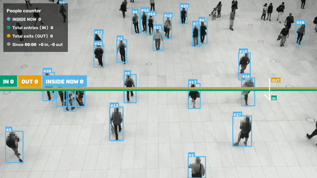

# People counter

How many people went in, how many came out, and how many are inside right now?



*Heads are pixelated. Video: Coverr on [Pexels](https://www.pexels.com/video/black-and-white-video-of-people-853889/)
(Pexels License). The line across the middle stands in for a doorway: walking down the frame is IN, up is OUT.
The GIF shows the first 9 s of the 13.6 s clip, one frame in 3: it ends at IN 8, OUT 7, the first 15 of the 18
crossings checked below.*

## Run it

```bash
uv run python scripts/get_samples.py people_counter
uv run vigia count --source samples/people_counter/overhead-walkers.mp4 --show
```

On your own camera, draw the counting line once (name it `door`, draw it so that IN is on your right as you go from
the first point to the second), then run on the stream:

```bash
uv run vigia zones my-door.mp4 --out scenes/my-door.json
uv run vigia count --source rtsp://camera/stream --scene scenes/my-door.json --show
```

## How it works

1. D-FINE finds the people in each frame and ByteTrack gives each one an id that lasts across frames.
2. Each person is followed by the bottom centre of the box (the feet). A crossing counts when the feet go from one
   side of the line to the other and end up at least 10 px clear of it (`--min-travel 20`: 10 px on each side). Someone
   hesitating on the line, or turning back, is not counted; a person counts at most once per direction until they
   cross back.
3. On screen, on the line and in the panel:
   - **IN**: total entries, everyone who crossed towards the IN side (green stripe, white arrow).
   - **OUT**: total exits, everyone who crossed the other way (orange stripe).
   - **INSIDE NOW** = IN − OUT, never below 0. The write-up this demo is based on called the running total of entries
     "INSIDE", which is not how many people are inside; here the two are separate numbers.
   - Entries and exits in the current 15-minute slot, also kept for the whole run in the summary (`per_15min`).
4. Each person shows its track id and the last 1.5 s of its feet as a trail. When someone is counted, their box and
   trail turn green (IN) or orange (OUT) for a second, with the word IN or OUT next to the id.
5. Every crossing is saved as a small picture (`out/count-crossings/<time>-in|out-id<n>.jpg`: the person, the line
   and their trail at that moment, head pixelated), so anyone can check the count afterwards.

It counts crossings, never who crossed.

| Option | Default | Meaning |
|---|---|---|
| `--line` | `door` | name of the counting line in the scene |
| `--flip` | off | count the other direction as IN |
| `--min-travel` | 20 | pixels the feet must travel across the line (half on each side) |
| `--snapshots [folder]` | off | save a crop of every counted crossing (head pixelated) to check the counts by eye; folder defaults to `out/count-crossings` |

Each crossing goes to `out/count-events.jsonl` (`entered` / `exited`, with the track id, the counts after it, the
feet position and the snapshot path).

## Measured

On the sample clip (13.6 s, 1920×1080, 25 fps), checked by hand:

- **Precision: 18 of 18 counted crossings are real.** I looked at all 18 snapshots: each one is a single person whose
  feet cross the line in the direction logged (10 walking down = IN, 8 walking up = OUT). The group standing just
  below the line on the left for the whole clip is never counted.
- **Recall: 18 of 18 on this clip.** On frames every 0.5 s around the line I counted 18 completed crossings (10 down,
  8 up), the same 18 the counter found, at the same places and times. One more man reaches the line in the very last
  frame (13.6 s); neither I nor the counter count him, as the clip ends before he is past it.
- The result is the same (10 in, 8 out) when processing every frame, one in 2 or one in 3, and with `--min-travel`
  from 12 to 30 px.

One person counting one short clip on 0.5 s samples is a sanity check, not a benchmark. INSIDE NOW ends at 2 here only
because two more people walked down than up: on an open plaza people also leave through the frame edges, so it means
"people inside" only when the line is the single way in and out, as in a doorway.

## Limits

- The camera must not move; if it does, redraw the line.
- INSIDE NOW starts at 0: people already inside when counting starts are unknown.
- If the tracker loses someone and gives them a new id (occlusion), a person who reappears on the far side is not
  counted again, but one whose box comes back on the near side and then crosses is counted once more
  (`test_counter_id_switch_counts_once_more`).
- People walking so close together that they get one box are counted once. This clip has no crowd at the line.
- ByteTrack needs a few frames to confirm a new person: someone first seen already past the line is not counted.
- The feet are the bottom of the box. That is accurate from high up, as here; at eye level with people far from the
  camera, put the line where people are big and fully visible.
