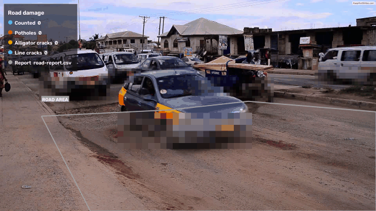

# Road damage

Which potholes and cracks are on this street, each counted once, with a report a city can act on?



*Faces, heads and the lower part of each vehicle (where number plates are) are pixelated. Video: "Pothole" by Amuzujoe, [Wikimedia Commons](https://commons.wikimedia.org/wiki/File:Pothole.ogv),
CC BY-SA 4.0. This GIF is derived from it and is CC BY-SA 4.0 too.*

## Run it

The model is exported once from its PyTorch checkpoint, in a throwaway environment so torch never becomes a
dependency (on Linux/macOS use `.export/bin/python`):

```bash
uv venv .export --python 3.12
uv pip install --python .export "rfdetr[onnx]==1.12.1" --index-url https://download.pytorch.org/whl/cpu     --extra-index-url https://pypi.org/simple --index-strategy unsafe-best-match
.export/Scripts/python.exe scripts/export_road_model.py
uv run python scripts/get_samples.py road_damage
uv run vigia road --source samples/road_damage/pothole-kumasi.mp4 --scene scenes/road-kumasi.json --show
uv run vigia road --source samples/road_damage/cars-into-pothole.mp4 --scene scenes/road-cars.json \
    --report out/road-cars-report.csv --show
```

From a camera fixed on a street, draw the road area once (a zone named `road`) and run on the stream. From a
vehicle (dashcam, the view the model was trained on) there is no zone, the whole frame goes to the model, and the
same-spot rule must be off because the picture moves:

```bash
uv run vigia zones my-street.mp4 --out scenes/my-street.json
uv run vigia road --source rtsp://camera/stream --scene scenes/my-street.json --show
uv run vigia road --source dashcam.mp4 --rematch 0 --out out/road.mp4
```

## How it works

1. RF-DETR Small fine-tuned on RDD2022 finds four kinds of damage: **pothole**, **alligator crack**,
   **longitudinal crack** and **transverse crack**. It runs with OpenVINO on the Intel NPU when there is one
   (its boxes match the CPU's, checked below), else on the CPU.
2. With a scene, only the road area goes to the model, cut into overlapping 360 px squares (`params.tile`), each
   enlarged to the model's 512 px: from the roadside the road is far and flat, and cracks are thin.
3. Boxes whose centre is outside the road area are dropped, and so are boxes mostly (>= 50 %) inside a vehicle
   found by D-FINE: a "pothole" on a motorbike or a wheel is not road damage.
4. ByteTrack follows each damage from frame to frame. A track starts at 0.3 confidence; weaker boxes (>= 0.15)
   only keep an existing track alive.
5. A damage is **counted once**, after 3 tracked frames. If a car hides it and the tracker gives it a new id, a new
   track on the same spot (IoU >= 0.3 with a damage seen in the last 5 s) is the same damage, not a new one.
6. For each damage it keeps when it was first seen, its class (from its most confident view), the highest
   confidence and a crop of the frame where it was most confident. At the end it writes the report.

On screen: `#3 pothole 81%` is counted damage number 3; a grey `pothole?` is still being checked.

| Option | Default | Meaning |
|---|---|---|
| `--conf` | 0.3 | confidence a damage needs to start being tracked |
| `--min-frames` | 3 | tracked frames before a damage counts |
| `--tile` | scene's `params.tile`, else none | squares of N px cut from the road area (a zoom) |
| `--rematch` | 5 | seconds a counted damage keeps its spot; use 0 from a moving vehicle |
| `--report` | `out/road-report.csv` | the report; crops go next to it, in `out/road-crops/` |

The report has one row per damage:

```csv
id,first_seen,first_t,label,max_score,crop_path
1,0:02,2.1,alligator crack,0.46,out/road-crops/damage-001.jpg
2,0:03,3.3,alligator crack,0.48,out/road-crops/damage-002.jpg
```

(The Kumasi clip, first 12 s.) `out/road-events.jsonl` gets a `damage_found` event when each damage is counted
(time, track id, class, confidence).

## Measured

What I checked by eye on the saved output of the two sample clips. Two short clips are a sanity check, not a
benchmark, and no damage was labelled by hand, so there is no precision or recall here.

- **Kumasi, side view (first 12 s, every 3rd frame, 120 frames):** 2 damages counted, at 0:02 and 0:03, both
  stretches of broken gravel surface on the right of the road that the model calls alligator cracking (best 0.46 and
  0.48). Each keeps its number while cars, a tricycle and a motorbike pass over it, and neither is counted twice.
  The pothole the video is named after (a dark hole mid-road) is not found. Nothing on a vehicle is counted. The
  boxes have the edges of a 360 px square because the model marks the whole square as damaged. The GIF is the same
  clip, first 9 s, every 5th frame: same 2 damages at 0:02 and 0:03.
- **Cars into pothole (20.7 s, every 6th frame, 104 frames):** 1 damage counted at 0:12: the pothole the cars drive
  through, labelled alligator crack (0.52) rather than pothole. Before that it is hidden by queuing vans and the
  camera pans.
- **Vehicles:** in a one-frame-per-second scan without the vehicle filter, the model fired on a van, a wheel and a
  motorbike at 0.17-0.25, all below the 0.3 needed to start a track, so the filter's effect on these clips is not
  measured.
- **Same boxes as the original model:** on 9 sample images (6 frames, 3 crops), this ONNX + OpenVINO pipeline gives
  every box that rfdetr 1.12.1's own `predict()` scores >= 0.15, with the same class, IoU > 0.9 and a confidence
  within 0.006. The NPU gives the same boxes as the CPU.
- **Speed (Core Ultra 7 258V, with other demos running at the same time):** one 512 px inference takes 85 ms on the
  NPU and 550-640 ms on the CPU. A Kumasi frame (12 squares, plus D-FINE for people and vehicles, plus the saved
  output) took about 2.2 s, a cars frame (10 squares) about 1.6 s. Without a scene (one image per frame, the dashcam
  setup) it is one inference per frame; that case is not timed.

The model author's own numbers, quoted as theirs: mAP50 64.7 % and mAP50-95 35.7 % (mAP50 per class: pothole
74.9 %, alligator crack 66.7 %, transverse crack 59.0 %, longitudinal crack 58.4 %), on a random 70/15/15 split of
the publicly labelled RDD2022 images, merged across countries. That is not the official CRDDC2022 test set (its
labels are not public), so it is not comparable with the challenge leaderboard, and it says nothing about roads
filmed from the roadside like these clips.

## Limits

- The model learned from photos taken from vehicles looking down the road. From the roadside, as in both sample
  clips, it is much weaker: 3 damages found in 33 s of badly broken road, the clearest pothole labelled as alligator
  cracking and another pothole missed. Use it from a vehicle or a camera looking down at the road, and check every
  row before acting on it.
- Pothole and alligator crack are often confused on broken surfaces; the crop is there so a person can tell.
- With squares, a damage larger than a square is reported once per square, so a long broken stretch counts as
  several damages.
- The same-spot rule assumes a still camera. From a moving vehicle use `--rematch 0`; then a damage the tracker
  loses and finds again is counted again. There is no GPS: the report gives video time, not a place.
- Crops are cut from the original frames and are not pixelated: they can show number plates or people. Check them
  before sharing the report. Saved video and GIFs pixelate faces, heads and the plate area of every vehicle D-FINE
  finds; a vehicle it misses keeps its plate.
- With squares it takes about 1.5 s per frame on the NPU and 3 s on the CPU of this laptop: it is for recorded
  video with `--every`, not live.

## Data, model and licences

- Model: [dronefreak/rdd2022-rfdetr-small](https://huggingface.co/dronefreak/rdd2022-rfdetr-small), RF-DETR Small
  (Roboflow, Apache-2.0) fine-tuned by its author on RDD2022; weights Apache-2.0.
- Training data: RDD2022, the Road Damage Dataset 2022 (Arya et al., Crowdsensing-based Road Damage Detection
  Challenge), road photos from six countries, CC BY-SA 4.0.
- Videos: "Pothole" (Kumasi, Ghana, 2020) and "Cars Moving into pothole" (Kumasi, 2020), both by Amuzujoe on
  Wikimedia Commons ([1](https://commons.wikimedia.org/wiki/File:Pothole.ogv),
  [2](https://commons.wikimedia.org/wiki/File:Cars_Moving_into_pothole.webm)), CC BY-SA 4.0. `docs/gifs/road.gif` is
  an adaptation of the first and is shared under CC BY-SA 4.0.
