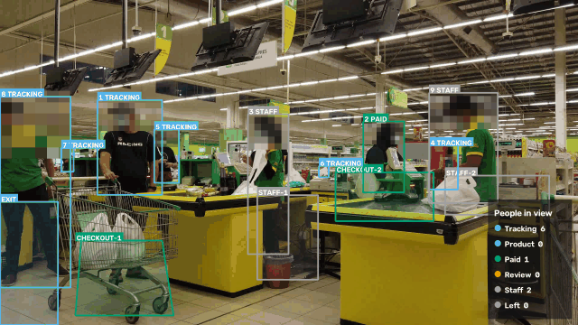

# Store flow

Which shoppers picked something up at a shelf and then left without passing a checkout, so that a person can take a
look? Plus how long people spend in each zone.



*Faces and heads are pixelated. Video: Nazim Zafri on [Pexels](https://www.pexels.com/video/people-paying-at-the-counter-in-the-supermarket-4249560/).
The clip only shows checkouts, so the GIF shows PAID, STAFF and LEFT; see [what the sample does not show](#measured).*

## Run it

```bash
uv run python scripts/get_samples.py store_flow
uv run vigia store --source samples/store_flow/checkouts.mp4 --show
```

On your own fixed camera, draw the zones once and run on the stream:

```bash
uv run vigia zones my-shop.mp4 --out scenes/my-shop.json
uv run vigia store --source rtsp://camera/stream --scene scenes/my-shop.json --show
```

Zones are found by the start of their name: `shelf-*`, `checkout*`, `exit*` and `staff*`. Any other zone (an
`entrance`, say) is only drawn. A person is in a zone when their feet (bottom centre of the box) are inside it.

## How it works

1. D-FINE finds the people and ByteTrack gives each one a tracker id. When the detector returns a whole person and
   also the part above a counter or a cart, the two boxes are merged into the whole one.
2. Each id follows a small state machine:

   | From | When | To | Event |
   |---|---|---|---|
   | TRACKING or PAID | 4 s in the same shelf zone (gaps under 1 s ignored) | PRODUCT | `product` |
   | TRACKING or PRODUCT | feet in a checkout zone | PAID | `paid` |
   | PRODUCT | reaches the exit without a checkout | **REVIEW** | `exit_without_checkout` |
   | TRACKING or PAID | reaches the exit | LEFT | `left` |
   | any | feet in a staff zone, even once | STAFF (left out from then on) | `staff` |

   Someone first seen *inside* the exit zone is coming in, not leaving. Walking past a shelf in under 4 s is not a
   product. PAID only means "stood in a checkout lane": the camera does not see a payment.
3. **REVIEW means "left without passing a checkout after picking a product, worth a human look"**. It is never a
   finding of theft: the product may have been put back on another shelf, the person may have paid at a lane the
   camera does not cover, or the tracker may have mixed two people up.
4. The summary at the end gives how many ids entered each state and, per zone, the distinct visitors, the
   person-seconds and the mean seconds per visitor (staff left out). Every change goes to `out/store-events.jsonl`.

People are told apart only by the tracker id: there is no face recognition and no identity, and paths are dropped
30 s after a person is last seen.

| Option | Default | Meaning |
|---|---|---|
| `--dwell` | 4 | seconds in a shelf zone that count as picking a product |

## Measured

The two free sample clips are weak for this demo, and this section says how.

- **Neither camera is fixed.** Comparing the first frame with later ones (phase correlation), `checkouts.mp4`
  (9.3 s, filmed at chest height) drifts about 2.5 % of the frame width sideways, and `aisle.mp4` (6.5 s) about
  1.5 % sideways and 3.5 % vertically. Over clips this short the zones still fit; on a real install the camera must
  be mounted.
- **`aisle.mp4` is not used:** one shopper is visible for about 2 s, walking with a cart, before a display hides her.
  There is no stay at a shelf and no exit in view.
- **`checkouts.mp4` shows checkouts only**, so the GIF can only show PAID, STAFF and LEFT. **PRODUCT and REVIEW
  never happen on video; those paths are covered only by the unit tests** (`tests/test_store.py`: normal purchase,
  exit without checkout, product picked after paying, browsing without a product, staff excluded, short shelf
  pass, short detection gaps, first seen at the exit, ID switch).

What happens on `checkouts.mp4` (every 2nd frame, D-FINE-M), with each of the 11 events in
`out/store-events.jsonl` checked against the frames by hand:

| Event | Ids | What it really is |
|---|---|---|
| `paid` | #1, #2 | the two customers at the two lanes: correct |
| `staff` | #3, #9 | the two cashiers behind the counters: correct |
| `left` | #28 | the person who walks right past the lens and leaves on the left: correct by the zone rules |
| `paid` | #35 | customer #1 again, with a new id after #28 hid him |
| `staff` | #31 | cashier #3 again, with a new id after the same occlusion |
| `paid` | #26 | a worker in uniform walking through lane 1: staff are recognised only by zone |
| `paid`, `staff` | #17, #11, #16 | extra short-lived boxes on a customer and a cashier |

So the summary says 5 PAID and 5 STAFF ids for 2 customers and 3 workers. Before the whole-body merge (step 1 of
*How it works*), customer #1 alone got 6 ids in his first 3 s, because the cart hides his legs and the detector
switches between his whole body and his top half.

The per-zone times have the same problem: customer #1 stands in lane 1 for the whole clip, yet `checkout-1` adds
up only 3.3 person-seconds, because when the cart hides his legs the box stops at the cart handle and his "feet"
are outside the lane. Read the dwell times as a lower bound when feet are often hidden.

Speed is not measured here (other jobs shared the machine); see `scripts/bench.py`. One short clip is a sanity
check, not a benchmark.

## Limits

- **Occlusion and ID switches break a path.** If a person is hidden (behind a shelf, a cart, another shopper) for
  longer than the tracker's 1 s memory, they come back with a new id and an empty history. A product picked before
  the switch is forgotten, so a REVIEW can be missed; if two people swap ids, one can inherit the other's history,
  so a REVIEW can also be wrong. Counts are per id, so one person can count more than once (see *Measured*).
- **Staff are recognised only by zone.** A worker who never steps into a staff zone is treated as a shopper; a
  shopper who steps behind a counter is excluded. There is no uniform or badge recognition.
- No face recognition and no identity: the system cannot say that two ids are the same person, today or another day.
- The camera must not move. The zones are fixed in the image; if the camera is bumped, redraw them.
- "Picking a product" is inferred from standing at a shelf for `--dwell` seconds. Looking without touching counts;
  a quick grab under 4 s does not.
- People seen from very far away (a few pixels tall) are often missed or flicker between ids.

## Responsible use

A system that tracks shoppers is processing personal data (images of identifiable people), so in the EU:

- **GDPR**: you need a lawful basis (usually legitimate interest, with a written balancing test), the minimum data
  for the purpose and a short retention period. Keep events and aggregates, not footage, wherever you can.
- **Signage**: people must be told before they enter the filmed area. In Spain, art. 22.4 LOPDGDD asks for a sign in a
  visible place saying that there is a camera, who is responsible and how to exercise data-protection rights.
- **Staff**: cameras that also film workers fall under art. 89 LOPDGDD (inform them beforehand). This demo leaves
  staff out of the paths, but they are still filmed.
- **A human decides.** A REVIEW is a timestamp to look at, never grounds on its own to stop, search or accuse anyone.

Practical defaults that follow from this: no identities, faces pixelated in anything saved (on by default), neutral
labels only, and only aggregates in the summary.

## Data

Sample videos are downloaded by `scripts/get_samples.py` and are not in the repo (Pexels License):
`checkouts.mp4` by Nazim Zafri ([Pexels 4249560](https://www.pexels.com/video/people-paying-at-the-counter-in-the-supermarket-4249560/)),
`aisle.mp4` by JMT 35 ([Pexels 34506445](https://www.pexels.com/video/typical-day-in-a-store-aisle-34506445/)).
