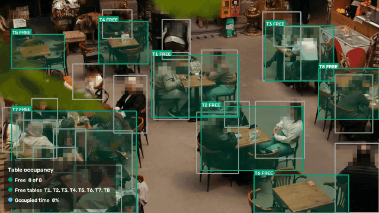

# Table occupancy

Which café tables are free right now, and for how long have the others been taken?



*Faces and heads are pixelated. Video: Talha Uğuz on [Pexels](https://www.pexels.com/video/lively-turkish-cafe-scene-from-above-34569882/).*

## Run it

```bash
uv run python scripts/get_samples.py table_occupancy
uv run vigia tables --source samples/table_occupancy/cafe-from-above.mp4 --show
```

On your own camera, draw each table area once (name them `table-1`, `table-2`…), then run on the stream:

```bash
uv run vigia zones my-cafe.mp4 --out scenes/my-cafe.json
uv run vigia tables --source rtsp://camera/stream --scene scenes/my-cafe.json --show
```

## How it works

1. D-FINE finds the people in each frame.
2. A person is *at* a table when at least 30 % of the lower half of their box (legs, chair, lap) lies inside the
   table area. Someone walking past the edge does not.
3. A table becomes **OCCUPIED** after 3 s with someone at it and **FREE** after 10 s empty. Gaps under 1 s (a
   missed detection, someone leaning out of view) are ignored, so a waiter crossing never flips a table.
4. It reports the time in the current state, the list of free tables and the share of table-time occupied.

It works on table areas, never on who the person is.

| Option | Default | Meaning |
|---|---|---|
| `--occupy-after` | 3 | seconds someone must stay before the table counts as occupied |
| `--free-after` | 10 | seconds empty before it is free again |

Every change goes to `out/tables-events.jsonl` (`table_occupied`, `table_freed` with how long it was taken).

## Measured

On the sample clip (10.9 s, 8 tables), checked by hand: all 8 tables end in the right state (6 occupied, 2 free),
and the waiter crossing the room does not flip any of them. No table changes state in this clip, so the free/occupy
delays are covered by the unit tests (`tests/test_tables.py`), not by this video. One short clip is a sanity check,
not a benchmark.

## Limits

- The camera must not move; if it does, redraw the zones.
- Someone standing next to a table for more than 3 s counts as occupying it.
- Heavy occlusion (plants, tall people in front) can hide seated customers; `--free-after` absorbs short gaps.
- For the first 3 s every table shows FREE while the evidence builds up.
